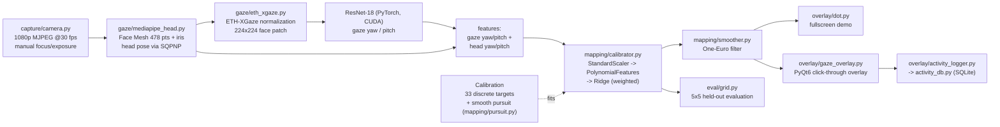

# Gazetrack: webcam gaze tracking

Gazetrack estimates where you are looking on screen using an ordinary RGB webcam. It runs a CNN gaze model on the GPU, maps its output to screen pixels with a calibration done per session, and draws a smoothed cursor over your desktop.

## What it does

Dedicated eye trackers rely on infrared hardware. Gazetrack tests how much accuracy a 1080p webcam can reach, and then builds a local, privacy-first productivity sensor on top of it.

- Captures 1080p at 30 fps from a Logitech C920/C922 with focus and exposure locked, then checks that the camera actually delivers that mode.
- Finds the face and head pose with MediaPipe Face Mesh (478 landmarks including the iris) and solves the pose with PnP.
- Estimates gaze direction (yaw, pitch) with an ETH-XGaze ResNet-18 on CUDA, using the face patch after ETH-XGaze normalization.
- Maps gaze and head pose to screen coordinates with a regularized polynomial regression. It is trained on a 33-target grid, and optionally on a smooth-pursuit trajectory as well.
- Smooths the cursor with a One-Euro filter. You can view it in a fullscreen demo or in a transparent, click-through overlay on top of your real applications.
- Evaluates accuracy on a held-out 5x5 grid. It reports error by zone (center, edges, corners) and in a 3x3 regional breakdown, in px, % of screen width, cm and degrees.
- Optionally logs behavior in the background to a local SQLite database: gaze zone, presence, active window, and keyboard/mouse event counts. Key content is never recorded.

## Architecture



The system is split into two layers that do not share responsibilities.

- **Layer 1, gaze direction (GPU).** `capture`, `gaze/mediapipe_head.py` and `gaze/eth_xgaze.py` turn a camera frame into head pose plus a gaze vector in camera space. The face is warped into the ETH-XGaze normalized space: a virtual camera at 600 mm with a 960 px focal length, looking straight at the face. The CNN's output is then rotated back to the real camera frame.
- **Layer 2, screen mapping (per session).** `mapping/calibrator.py` never sees frames or the model. It receives a `sample_provider` callable that `main.py` connects to layer 1. The feature vector has four values (gaze yaw/pitch, head yaw/pitch) and is versioned, so calibrations saved with an older format are rejected. Calibrations are saved as plain YAML, without pickle.
- **Consumers.** `main.py` exposes the CLI (`screen`, `calibrate`, `demo`, `overlay`, `record`, `evaluate`). The overlay runs the blocking camera, CNN and mapping loop in a `QThread`, and only repaints the area around the cursor.

## Tech stack

From `requirements.txt`:

- Python 3.10 (`check_env.py` expects 3.10.x)
- PyTorch 2.5.1 + torchvision 0.20.1 (CUDA 12.1 builds)
- MediaPipe 0.10.14 (Face Mesh)
- OpenCV contrib 4.10.0.84 (capture, PnP, warping, demo UI)
- NumPy 1.26.4, scikit-learn 1.5.2 (polynomial Ridge regression, cross-validation)
- PyYAML 6.0.2 (calibration and config persistence)
- PyQt6 6.7.1 (transparent overlay, settings panel, tray)
- pywin32 306, pynput 1.7.7, psutil 6.0.0 (Windows overlay styles, input event counting, foreground process)
- SQLite (standard library) for the activity log
- Model: ETH-XGaze ResNet-18 checkpoint from the `hysts/pytorch_mpiigaze_demo` release. It downloads on first use and is verified by SHA-256.

## Results

These figures are recorded in the project log (`PROJECT.md`, section 5, "FASE 1B CERRADA"). They come from the held-out 5x5 `evaluate` run after combined calibration (33 discrete targets plus 2760 smooth-pursuit samples), on a single user with a 49" 32:9 ultrawide (3840x1080) at about 75 cm.

| Metric | Discrete-only baseline | Combined calibration |
|---|---|---|
| Global mean error | 246.9 px (6.41% of width) | 166.9 px (4.35% of width) |
| Center zone | - | 105.3 px / 2.51 deg |
| Edge zone | - | 107.6 px / 2.56 deg |
| Raw jitter | 76.4 px | 49 px (1.28% of width) |

- The block-CV model selection picked degree 2 over degree 3 (124.8 px vs 132.6 px), with a pursuit latency compensation of 250 ms.
- The center zone meets the original phase target of 3.5 deg or better.
- Known limitation: one top-left corner target scored 1482 px, which inflates the corner-zone and global figures. `PROJECT.md` lists it as an open item.

## Running locally

Requirements:

- Windows. The overlay and activity logger use pywin32, and capture uses the MSMF/DirectShow backends.
- Python 3.10.
- An NVIDIA GPU with a driver that supports CUDA 12.1. A CPU-only PyTorch build is treated as a hard error.
- A 1080p USB webcam. The code is tuned for the Logitech C920/C922.

Install and verify:

```bat
python -m venv .venv
.venv\Scripts\python.exe -m pip install -r requirements.txt
.venv\Scripts\python.exe check_env.py --camera
.venv\Scripts\python.exe -m capture.camera --focus-sweep
```

`check_env.py` checks every import, confirms that PyTorch is a CUDA build, and runs a matmul on the GPU. It also checks for the model weights and, with `--camera`, opens the camera and confirms the requested mode. The focus sweep is a one-time interactive step that saves manual focus and exposure to `data/camera.yaml`.

Run:

```bat
.venv\Scripts\python.exe main.py screen --screen-width-cm 120 --screen-height-cm 34 --distance-cm 70
.venv\Scripts\python.exe main.py calibrate --pursuit   # 33-target grid + smooth pursuit
.venv\Scripts\python.exe main.py evaluate              # held-out 5x5 accuracy report
.venv\Scripts\python.exe main.py demo                  # fullscreen gaze dot
.venv\Scripts\python.exe main.py overlay               # click-through overlay on the desktop
.venv\Scripts\python.exe main.py record --background   # overlay + local activity logging
```

You can also test each component on its own: `python -m capture.camera --preview`, `python -m gaze.mediapipe_head` and `python -m gaze.eth_xgaze`. Everything runs locally, and all runtime data goes to `data/`, which git ignores.

### macOS (Apple Silicon): layer 1 only

Which requirements file to use:

| Platform | File | GPU backend |
|---|---|---|
| Windows (primary rig) | `requirements.txt` (`+cu121` builds) | CUDA |
| macOS, Apple Silicon | `requirements-macos.txt` (same versions, standard PyPI builds, no pywin32) | MPS (Metal) |

Status on macOS: layer 1 (camera, MediaPipe, ETH-XGaze, gaze yaw/pitch) runs and was verified live on an M1 MacBook. The calibration UI, overlay and activity logger have not been ported yet (the logger and overlay rely on win32 APIs).

```bash
brew install python@3.12
/opt/homebrew/bin/python3.12 -m venv .venv
.venv/bin/python -m pip install -r requirements-macos.txt
.venv/bin/python check_env.py
.venv/bin/python -m gaze.eth_xgaze
```

- `check_env.py` uses `sys.platform`: on macOS it requires `torch.backends.mps.is_available()` and runs a matmul on MPS; on Windows it still requires CUDA.
- Inference picks the device with `--device auto` (default): CUDA, then MPS, else a clear error. There is no silent CPU fallback.
- Capture uses AVFoundation. OpenCV's AVFoundation backend has no focus, autofocus or exposure controls, so these settings have no effect on macOS: the camera stays on auto focus and auto exposure, and `--focus-sweep` reports that it is unavailable. Resolution and fps are printed as measured values.
- Camera index: an iPhone used as Continuity Camera can enumerate as index 0 and stream black frames. On the test MacBook the built-in FaceTime camera was index 1 (1280x720 at 30 fps). Set it once with `--index 1`, or persist it in `data/camera.yaml` (`index: 1`).
- macOS asks for camera permission for the app that launches Python (Terminal, iTerm, an IDE). Allow it, or enable it later in System Settings > Privacy & Security > Camera, then run the command again.

## What I learned / key technical decisions

- **I kept two strict layers.** The screen mapper only consumes angles through a `sample_provider` and never touches frames or the CNN. Because of that, I could test calibration, cross-validation and serialization headless, and I could add pursuit data and the overlay without changing the gaze model.
- **I fixed the PnP head model, which was silently ruining the CNN input.** The generic 3D face model was about 3.3x too large, so PnP placed the face at roughly 1.9 m. The ETH-XGaze normalization then cropped only the nose and mouth. I replaced it with real anthropometric points in millimetres and switched to `SOLVEPNP_SQPNP`, because the iterative solver fell into the mirrored solution on a nearly flat face. I also added a startup check that warns when the PnP distance falls outside 400-1000 mm.
- **I treated overfitting as the main risk in calibration.** An early 7-input feature vector gave 35 polynomial terms for only 33 samples, so evaluation error was about 22x the training residual. I dropped the absolute face position, chose alpha by explicit leave-one-out, added a guardrail on the feature-to-sample ratio, and made `evaluate` measure raw, unclamped predictions so a runaway model cannot hide at the screen edges.
- **I used block-wise temporal cross-validation for smooth pursuit.** Pursuit samples are autocorrelated, so random k-fold would report errors that are too optimistic. The combined calibration picks polynomial degree, Ridge alpha and the pursuit latency offset with contiguous-block k-fold. The target position is computed analytically at `t - lag` instead of taking the nearest recorded frame.
- **I trusted measured behavior over driver readbacks.** On the C922, DirectShow always fell back to YUY2 at 5 fps at 1080p, whatever FOURCC was requested. Switching to MSMF first, without passing a FOURCC, fixed it. The capture code now treats measured fps as the ground truth and prints real runtime properties every time the camera opens.

## Author

**Washington X. Quevedo**

- LinkedIn: https://www.linkedin.com/in/wxquevedo
- GitHub: https://github.com/wx-quevedo
